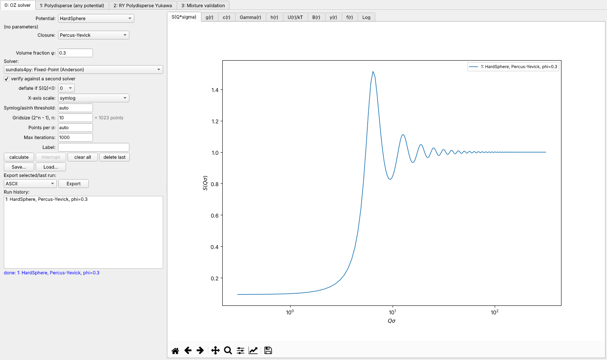
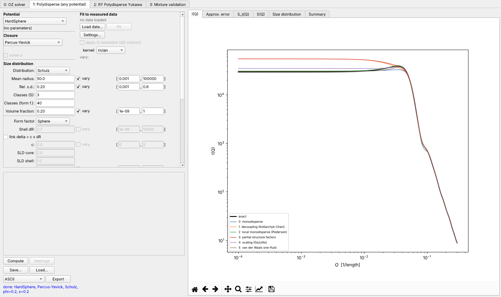

# pysasfit.oz — Ornstein–Zernike toolkit and its Qt GUI

`pysasfit.oz` is pyOZgui (`SASfitGit/src/pyOZgui`) inside pySASfit:

- **Library**: all modules of `src/pyozgui`, unchanged except that their imports between each other are now
  package-relative (`from .ozLib import ...`). Use them as `from pysasfit.oz import ozLib`,
  `from pysasfit.oz.picardOZsolver import PicardOZsolver`, …
  Not carried over: `criticalDensities.py` and `optimizeRYalpha.py` (Python 2 `print` statements; they never imported
  under Python 3).
- **GUI**: the Tk GUI is ported to Qt (PySide6) in `pysasfit.oz.gui`. Start it with `pysasfit-oz`, or use the
  "Ornstein-Zernike" tab of `pysasfit-gui`.
- **C helper libraries**: `librmsa.dll` is included for Windows. The sources of librmsa, liboneyukawa, liborpa and
  librfa are in `extern/oz`, with `build_windows.bat` per library (MSYS2/MinGW) and `build_linux.sh` for Linux/macOS
  (needs GSL). The wrappers look for the libraries next to themselves in `src/pysasfit/oz`.
- **Tests**: `tests/oz` (library: `test_generic_polydisperse.py`, `test_multicomponent.py`, SAS/S(Q) validation) and
  `tests/oz_gui` (every tab, offscreen, with dialogs intercepted).

The other documents in this folder (`gui.md`, `generic_polydisperse_tab.md`, `manual.md`, `api.md`) are pyOZgui's
documentation. They describe the same tabs and controls. Module names now carry the `pysasfit.oz.` prefix, and the
screenshots in `figures/gui_*.png` show the Tk version; `figures/qt_*.png` show the Qt version.

## GUI modules

| Tk module (pyOZgui) | Qt module (`pysasfit.oz.gui`) | tab |
|---|---|---|
| `oZgui.py` | `main_window.py` (`OZMainWindow`, embeddable `OZWidget`), `oz_solver_tab.py` | 0: OZ solver |
| `generic_polydisperse_tab.py` | `generic_polydisperse_tab.py` | 1: Polydisperse (any potential) |
| `ry_polydisperse_yukawa_tab.py` | `ry_polydisperse_yukawa_tab.py` | 2: RY Polydisperse Yukawa |
| `mixture_validation_tab.py` | `mixture_validation_tab.py` | 3: Mixture validation |
| `polydisperse_yukawa_tab.py` | `polydisperse_yukawa_tab.py` | not registered (as in pyOZgui) |
| `robertus_shs_tab.py` | `robertus_shs_tab.py` | not registered (as in pyOZgui) |
| `polydisperse_tab_controls.py` | `tab_controls.py` | shared button row / session / export mixin |
| — | `qtkit.py` | Tk-style variables, widget factories, dialogs, queue poller, plot tabs |

Layout, labels, defaults, help texts, hover help, session files (`.oz`, `.oz1`, …, same JSON formats, so files saved
by the Tk version load in the Qt version), autosave, fitting and the Settings dialog are kept. Workers still run in
threads; results reach the GUI through a queue drained by a `QTimer` instead of Tk's `after()`.

`qtkit.set_dialog_hook()` lets tests (and scripts) answer dialogs without showing them.

## Behaviour changes and bug fixes made during the port

- **Sign convention A, project-wide: positive = attractive.** Every well depth and Yukawa amplitude is positive for
  attraction (βu = −ε, βu = −K e^{…}/r), as in the SASfit structure-factor plugins and the literature
  (`pysasfit.oz.sign_convention`). Three pyOZgui potentials used the opposite sign and were flipped: `SquareWell` ε,
  `PiecewiseConstantHS` ε₁…ε₃ and the single `Yukawa` strength. `HardSphereDoubleYukawa`, `HS3Yukawa` and the
  polydisperse MSA/RY Yukawa K were already convention A. The RFA wrapper converts at its boundary (its C library
  takes βu), so RFA, ORPA and the numerical square well now take the same number. Generic-tab session files without
  a `signConvention` key are converted on load (values, fit bounds, fitted value) and the status line says so; the
  potential fields carry a "(+ = attr.)" label. The single `Yukawa`'s repulsive/attractive split, used by HMSA and
  similar closures, was the bare shape without K; it is now the potential split by sign.

Each fix is marked in the code ("BUG FIX (Qt port)", "Port fix").

- **Robertus SHS and RY Yukawa tabs, core-shell:** `CoreShell` was called with the wrong arguments (positional
  shell/rho, or no arguments) and always raised "give exactly one of thickness, ratio".
- **RY Yukawa tab:**
  - Gamma and Beta distributions crashed with `KeyError: 'D0'`; their mean and s.d. now come from the moments.
  - A single bin gave a NaN bar width.
  - Interrupt could never be pressed; it now works, including between the solves of the α search.
  - The tab now saves and restores its settings in session files; before, its session files restored nothing.
- **Generic polydisperse tab:**
  - The fit summary was overwritten by the redraw and never visible after a Compute.
  - A non-numeric bound crashed the fit after the error message.
  - The Fit button stayed disabled after a failed fit.
  - The "fitter" help text was never attached.
  - The core-shell-only entries were found by creation order; they are now found by name.
- **Mixture validation tab:**
  - Save/Load dropped six settings that change the numerical curve: refinement, solver, damping, grid exponent,
    maximum iterations and deflation.
  - Loading left the previous summary on screen.
  - The N readout could crash (`inf`) or freeze (huge k).
  - Two help texts were never shown.
- **Generic tab:** the OZ solver and "Deflate if S(Q)<0" are now saved in session files (a reloaded session
  used to fall back to the default solver and no deflation). A solver not installed on the loading machine falls back
  to the first available one, and the status line says so; older files keep the current choice.
- **RY Polydisperse Yukawa tab:**
  - The selected size distribution is now used: the classes are its own quadrature nodes and weights
    (`discretize`, as in the MSA tab). pyOZgui built them from mean and s.d. only, evenly spaced over ±3 s.d. with
    log-normal weights, so every distribution gave the log-normal result and a rel. s.d. above 1/3 gave negative sizes.
  - The distributions are of the radius; the solver gets diameters σ = 2R. pyOZgui used the radius values as
    diameters (particles half the size entered). Results differ from pyOZgui's for both reasons.
- **RY and MSA Polydisperse Yukawa tabs:** "Mean radius" of the log-normal distribution is now the mean, as for
  Schulz-Zimm and in the generic tab. pyOZgui passed it to `LogNormal` as the median, so the actual mean was
  √(1 + rel.s.d.²) larger (2 % at 0.2, 4 % at 0.3).
- **Polydisperse Yukawa tab:**
  - One bin crashed the redraw and left Compute disabled.
  - The S_ij plot drew duplicate curves for N ≤ 2.

- **Deflation** ("Deflate if S(Q) < 0") in the polydisperse model (`GenericPolydisperseSAS`) now works: before, the
  retry solver was never set up or solved and the screen's result was ignored, so an unphysical root came back
  silently when deflation was on. The attempts are listed in the error message when no physical root is reached.
- **RY wrapper, automatic solver** (`solverClass=None`): the fallback to the next solver was unreachable and would
  have lost closure and deflation settings; fixed (`solverFallback` lists the solvers that failed).
- **OZ solver tab**: Hankel transform type selectable in the preferences (auto = 4 for one component, 1, 4).
- **OZ solver tab, Picard / Mann iteration**: the Picard solver is now "Picard / Mann iteration", with a field
  *damping a* (x ← (1−a)x + a·T(x); a = 1 plain Picard, a < 1 Mann's damped iteration). The start value is a
  preference (`oz.solve.mann_alpha`). `ozLib.solve()` has a `mannAlpha` argument, and the old name
  "Picard iteration" is still accepted. Convergence is now tested on the residual instead of the damped step,
  which with a < 1 would have stopped 1/a times too early. See [the GUI guide](gui.md).
- **Non-converged solves are reported**: `OZResult.converged` / `finalRelativeProgress`, a `RuntimeWarning`, and in
  the OZ solver tab a "[NOT CONVERGED]" label and a warning dialog. Before, the last iterate at the iteration
  limit was shown like a solution. For example, HS/PY at φ = 0.53 after 1000 Picard/Mann iterations looked as if
  the solution depended on a. The verification message now distinguishes "did not converge" from "two roots".
  For RMSA, ZSEP and the consistent-parameter search the flag was always False and now reports the final solve.
- **OZ solver tab, iteration limit**: the "Max iterations" field was removed. The limit comes from the
  preferences (`oz.solvers.max_iterations`, `oz.solvers.max_iterations_picard`). For Picard / Mann the limit is
  ⌈N/a⌉, and a grey line shows the value that will apply. The damping must satisfy 0 < a ≤ 1: the field turns
  red otherwise, and the library raises `ValueError`.
- **Physicality screen on every solve**: `ozLib.solve()` checks min S(Q) ≥ 0 always (before: only with
  `deflateOnUnphysical > 0`, default 0, so an unphysical root came back without notice). The result carries
  `minSq` and `physical`, gives a `RuntimeWarning`, and the OZ solver tab marks the run "[S(Q)<0]".
- **Independent residual check**: `ozLib.solve(residualTolerance=1e-6)` was accepted but never used. Now the
  closure map is applied once more to the returned solution, and the result is marked not converged when
  ‖T(x) − x‖/‖x‖ exceeds the tolerance, whatever the solver reported (`OZResult.residual`). The tolerance is a
  preference (`oz.solve.residual_tolerance`). Example caught: KIN_FP returning NaN with a success flag.
- **Verification**: verifiers must be independent of the solver they check. A verifier of the same algorithm
  family is skipped (`SOLVER_FAMILIES`; KIN_FP, scipy Anderson and MDIIS form one Anderson/DIIS family). Only a
  *converged* verifier counts. The defaults are Biggs–Andrews, then Picard / Mann damped with a = 0.5
  (preference `oz.solve.verify_mann_alpha`). The Picard limit was raised from 3000 to 5000 so that the damped
  verifier converges for dense hard spheres (φ = 0.53), where Biggs–Andrews and undamped Picard fail. If no
  verifier converges, `VerificationUnavailable` is raised, and the GUI shows the result marked "[UNVERIFIED]".
- SASfit's own C OZ solver (`sasfit_oz_potential_square_well.c`, `..._piecewise_constant_HS.c`, reached from
  `pysasfit.studio` through the `sq_oz_*` plugins) still uses βu = +ε. Values passed there keep SASfit's sign.

- `tests/oz/test_multicomponent.py::RegressionOneComponent` fails with the original code too: its stored reference
  values predate later solver changes. It is marked as an expected failure.
- **RY Yukawa tab:**
  - The α search always uses the default solver.
  - With the default parameters (φ = 0.15, z = 0.06, K = 1) no α in [0.02, 3] makes the two pressure routes agree,
    before and after the distribution fix; the summary reports this as "NO consistent alpha".
- **Generic tab:**
  - Fit can be started while a Compute is still running.
